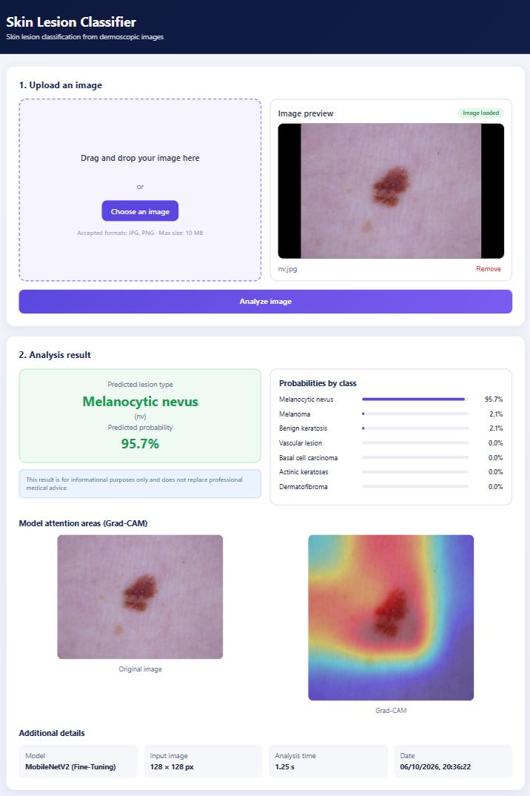
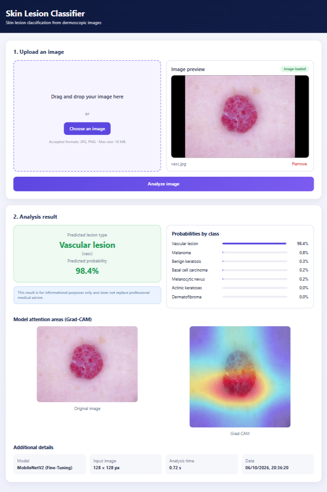
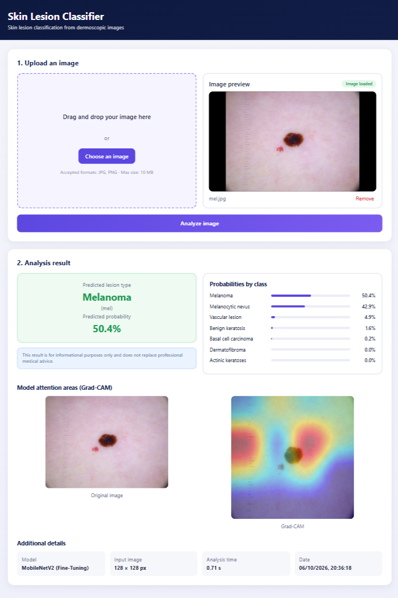
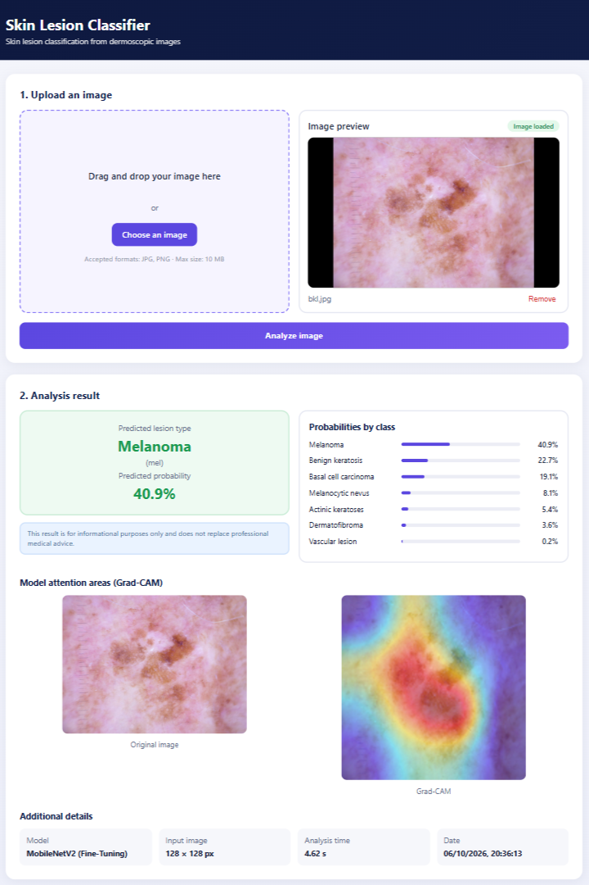
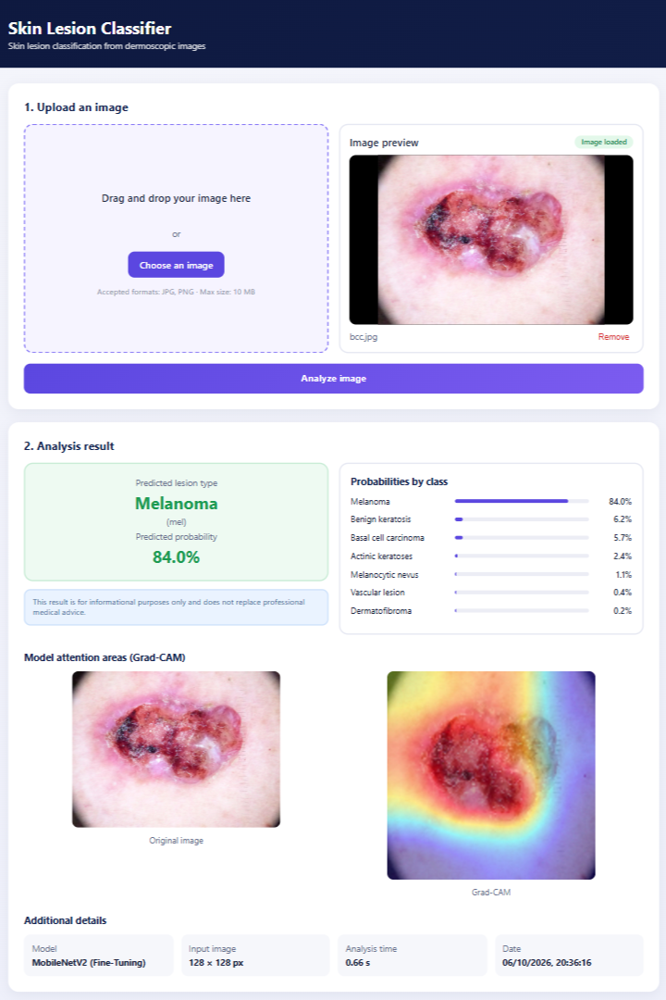
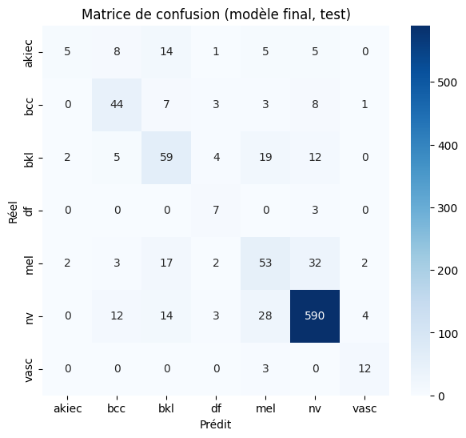
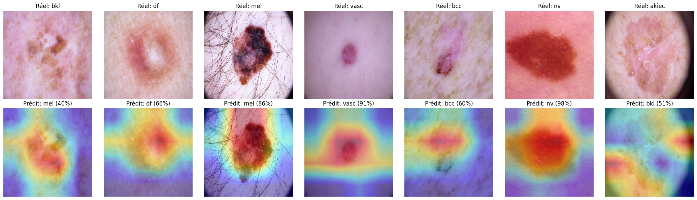

# Skin Lesion Classifier

End-to-end deep learning project that classifies dermoscopic images into 7 skin lesion types, served through a REST API with Grad-CAM explanations and a web interface.

> **Disclaimer:** this is an academic and experimental project. It is not a medical device, and its predictions must not be used for diagnosis or to replace the advice of a healthcare professional.

<p align="center">
  
</p>

## Highlights

- **Lesion-level data split** to prevent data leakage (HAM10000 contains several images of the same lesion).
- **Imbalance-aware training**: class weights and per-class evaluation (recall on melanoma, macro F1) instead of accuracy alone.
- **Model comparison**: CNN from scratch, MobileNetV2 transfer learning, and fine-tuning.
- **Explainability**: Grad-CAM heatmap returned with every prediction.
- **Full stack**: TensorFlow/Keras model, FastAPI backend, Angular frontend.

## Demo

Example predictions from the web interface, one image per class taken from the HAM10000 dataset. These images were picked for the demo and may come from the training split, so they illustrate the interface and are **not** a performance measure (see [Results](#results) for that).

| Melanocytic nevus (nv) | Vascular lesion (vasc) | Melanoma (mel) |
|---|---|---|
|  |  |  |
| Predicted **nv**, 95.7% | Predicted **vasc**, 98.4% | Predicted **mel**, 50.4% |

Two failure cases are shown on purpose: the model is not reliable on every class, and it can be confidently wrong.

| Benign keratosis (bkl) | Basal cell carcinoma (bcc) |
|---|---|
|  |  |
| Predicted **mel**, 40.9% (bkl got 22.7%) | Predicted **mel**, 84.0% (bcc got 5.7%) |

## Dataset

[HAM10000](https://www.kaggle.com/datasets/kmader/skin-cancer-mnist-ham10000) ("Human Against Machine with 10000 training images"): 10,015 dermoscopic images from 7,470 lesions.

| Code | Class | Images | Share |
|---|---|---|---|
| nv | Melanocytic nevus | 6,705 | 66.9% |
| mel | Melanoma | 1,113 | 11.1% |
| bkl | Benign keratosis-like lesion | 1,099 | 11.0% |
| bcc | Basal cell carcinoma | 514 | 5.1% |
| akiec | Actinic keratosis / Bowen's disease | 327 | 3.3% |
| vasc | Vascular lesion | 142 | 1.4% |
| df | Dermatofibroma | 115 | 1.1% |

The dataset is highly imbalanced and contains multiple images per lesion. The data is not included in this repository. Check the dataset page for its license and citation requirements before reuse.

**Split:** `StratifiedGroupKFold` grouped by `lesion_id` and stratified by class, giving 8,013 train / 1,010 validation / 992 test images (80/10/10), with no lesion shared between splits.

## Method

| Step | Notebook | Description |
|---|---|---|
| 1 | `01_exploration.ipynb` | Dataset exploration and lesion-level split |
| 2 | `02_baseline_cnn.ipynb` | CNN from scratch with augmentation and class weights |
| 3 | `03_transfer_learning.ipynb` | MobileNetV2 (ImageNet) with frozen base and new classification head |
| 4 | `04_fine_tuning.ipynb` | Fine-tuning of the last 30 layers (learning rate 1e-5, BatchNorm frozen) |
| 5 | `05_evaluation.ipynb` | Final evaluation on the held-out test set |
| 6 | `06_gradcam.ipynb` | Grad-CAM visualisation |

Common settings: 128x128 inputs, random flips/rotation/zoom, `sqrt`-smoothed balanced class weights, early stopping on validation loss.

## Results

Model comparison on the validation set:

| Model | Accuracy | Macro F1 | Melanoma recall |
|---|---|---|---|
| CNN from scratch | 59.4% | 0.208 | 0.041 |
| MobileNetV2 (frozen base) | 72.8% | 0.486 | 0.347 |
| **MobileNetV2 (fine-tuned)** | **75.3%** | **0.571** | **0.405** |

Final model on the held-out test set (992 images): **accuracy 77.6%, macro F1 0.566, macro ROC-AUC (one-vs-rest) 0.937**.

| Class | Precision | Recall | F1 | Support |
|---|---|---|---|---|
| akiec | 0.556 | 0.132 | 0.213 | 38 |
| bcc | 0.611 | 0.667 | 0.638 | 66 |
| bkl | 0.532 | 0.584 | 0.557 | 101 |
| df | 0.350 | 0.700 | 0.467 | 10 |
| mel | 0.477 | 0.477 | 0.477 | 111 |
| nv | 0.908 | 0.906 | 0.907 | 651 |
| vasc | 0.632 | 0.800 | 0.706 | 15 |

<p align="center">
  
</p>

### Explainability

Grad-CAM heatmaps (computed on the last convolutional block) highlight the regions driving each prediction. In most cases the model focuses on the lesion itself; for hard cases such as `akiec`, attention sometimes drifts to the image borders.



### Limitations

- Melanoma recall is below 50%: about one in two melanomas is missed, which would be unacceptable in a clinical setting.
- Rare classes (`df`, `vasc`, `akiec`) have very few test images, so their metrics are only indicative.
- A single dataset and a single split were used. There is no external validation, and results may not transfer to other devices or populations.
- Images are downscaled to 128x128, which also makes Grad-CAM heatmaps coarse (4x4 feature map).
- The model can be confidently wrong (see the `bcc` example above), so the confidence score is not a reliability guarantee.

## Architecture

```
Angular (localhost:4200)  --POST /predict (multipart image)-->  FastAPI (127.0.0.1:8000)
                                                                   |
                                                       Keras model + Grad-CAM
                          <-- JSON: class, probabilities, heatmap (base64 PNG), timing
```

### API

| Method | Route | Description |
|---|---|---|
| GET | `/health` | Health check |
| POST | `/predict` | Takes an image (`file`, JPG or PNG, 10 MB max). Returns the predicted class, confidence, probabilities per class, Grad-CAM overlay (base64 PNG) and inference time. |

Interactive documentation is available at `http://127.0.0.1:8000/docs` when the backend is running.

## Project structure

```
skin-lesion-classifier/
├── notebooks/         # experiments: exploration, training, evaluation, Grad-CAM
├── artifacts/         # trained model (git-ignored), class names, metrics
├── backend/           # FastAPI application
│   └── app/
│       ├── api/       # routes
│       ├── core/      # configuration
│       ├── schemas/   # response models
│       └── services/  # model loading, preprocessing, prediction, Grad-CAM
├── frontend/          # Angular application
└── docs/screenshots/
```

## Getting started

### Prerequisites

- Python 3.12 (TensorFlow does not provide wheels for Python 3.14)
- Node.js 22.12+ and npm
- A trained model at `artifacts/best_model.keras` and `artifacts/class_names.json`

Trained weights are not versioned (`*.keras` is git-ignored). To produce them, run notebooks 01 to 04 (Google Colab or Kaggle, GPU recommended), then save the fine-tuned model as `artifacts/best_model.keras`. `class_names.json` must contain the classes in training order:

```json
["akiec", "bcc", "bkl", "df", "mel", "nv", "vasc"]
```

### Backend

```bash
cd backend
python -m venv .venv
source .venv/Scripts/activate      # Windows (Git Bash); on Linux/macOS: source .venv/bin/activate
pip install -r requirements.txt
uvicorn app.main:app --reload
```

### Frontend

```bash
cd frontend
npm install
npm start
```

Open `http://localhost:4200`, upload a dermoscopic image and click **Analyze image**.

## Tech stack

| Layer | Technologies |
|---|---|
| Deep learning |     |
| Backend |       |
| Frontend |     |
| Experiments |   |

## Roadmap

- Docker and docker-compose setup
- Automated tests for the API and preprocessing
- Higher input resolution (224x224) and larger backbones (EfficientNet)
- Cross-validation and external validation
- Probability calibration

## Acknowledgements

- HAM10000 dataset: Tschandl, P., Rosendahl, C. and Kittler, H., "The HAM10000 dataset, a large collection of multi-source dermatoscopic images of common pigmented skin lesions", Scientific Data, 2018.
- MobileNetV2 weights pre-trained on ImageNet, provided by Keras.
